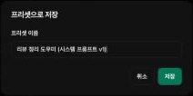
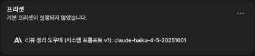
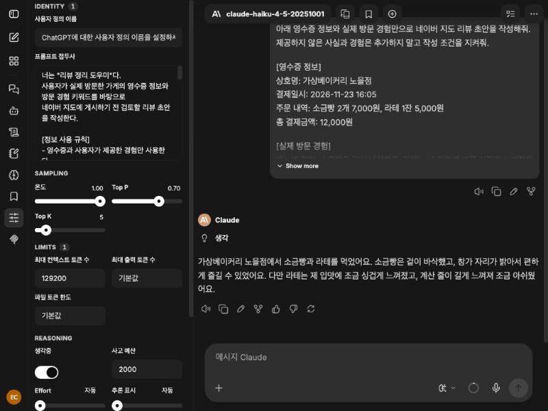
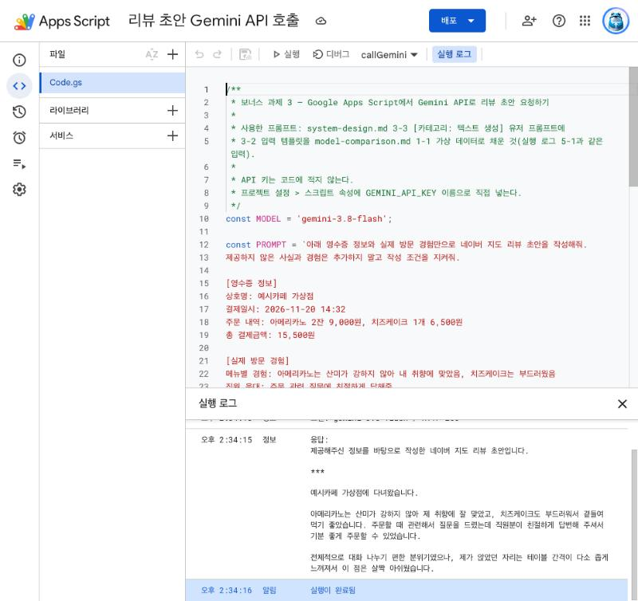

# 보너스 과제 기록

미션 5장 보너스 과제 3개의 진행 상태와 실제 기록이다.

| 번호 | 과제 | 상태 |
|---|---|---|
| 1 | 최종 프롬프트를 재사용 가능한 형태로 배포 | 완료 — 리브레챗 프리셋 |
| 2 | 대화 응답 하나를 이미지 생성 AI로 시각 자료화 | 완료 — Gemini 이미지 모델 |
| 3 | Google Apps Script에서 LLM API 호출 | 완료 — Gemini API 호출 성공(HTTP 200) |

## 1. 최종 프롬프트를 프리셋으로 배포

### 1-1. 배포한 것

- 배포 형태: 리브레챗(LibreChat v0.8.9)의 **프리셋**. 모델·매개변수·프롬프트 접두사(시스템 지침)를 한 묶음으로 저장해, 새 대화에서 메뉴 한 번으로 다시 불러온다.
- 프리셋 이름: `리뷰 정리 도우미 (시스템 프롬프트 v1)`
- 모델: Claude Haiku 4.5 (claude-haiku-4-5-20251001), model-comparison.md 5장 선정 모델
- 프롬프트: 요구사항 4에서 완성한 시스템 프롬프트를 그대로 사용했다. system-design.md 3-1 시스템 프롬프트 v1과 4장 Few-shot 예시 3개이며, 실행 로그 2-1의 전문(1,592자)과 글자까지 같다.
- 그 밖의 설정: 웹 검색 꺼짐, 온도 등 매개변수 기본값
- 저장 시점(KST): 2026-11-24 13:02





### 1-2. 다시 불러 쓴 결과

새 대화를 열고 프리셋 메뉴에서 `리뷰 정리 도우미 (시스템 프롬프트 v1)`을 골랐다. 불러온 프롬프트 접두사가 저장한 전문과 같은지(1,592자) 확인한 뒤, 처음 보는 가상 가게 정보를 system-design.md 3-2 입력 템플릿에 채워 보냈다.

- 실행 시점(KST): 2026-11-24 13:03
- 리브레챗 대화 ID: 3dcb5e87-fd6f-5842-9322-9f9e6df418e3

```text
User:
아래 영수증 정보와 실제 방문 경험만으로 네이버 지도 리뷰 초안을 작성해줘.
제공하지 않은 사실과 경험은 추가하지 말고 작성 조건을 지켜줘.

[영수증 정보]
상호명: 가상베이커리 노을점
결제일시: 2026-11-23 16:05
주문 내역: 소금빵 2개 7,000원, 라테 1잔 5,000원
총 결제금액: 12,000원

[실제 방문 경험]
메뉴별 경험: 소금빵은 겉이 바삭했음, 라테는 내 입맛에 조금 싱겁게 느껴졌음
직원 응대: 제공하지 않음
분위기: 내가 앉은 창가 자리가 밝았음
아쉬운 점: 계산 줄이 길게 느껴졌음
기타: 주차, 재방문 의사는 제공하지 않음

[작성 조건]
기본 조건 사용

위 정보를 바탕으로 리뷰 초안을 작성해줘.

AI:
가상베이커리 노을점에서 소금빵과 라테를 먹었어요. 소금빵은 겉이 바삭했고, 창가 자리가 밝아서 편하게 즐길 수 있었어요. 다만 라테는 제 입맛에 조금 싱겁게 느껴졌고, 계산 줄이 길게 느껴져 조금 아쉬웠어요.
```



### 1-3. 확인한 점

- 프롬프트를 다시 입력하지 않고 프리셋 선택만으로 같은 지침이 적용되었다. 3문장·한 문단, 결제일시·수량·가격 제외, 직원 응대·주차·재방문 의사 미언급을 지켰다.
- 다만 "창가 자리가 밝아서 편하게 즐길 수 있었어요"는 입력에 없는 경험(편하게 즐김)과 인과를 덧붙인 표현이고, 라테까지 "먹었어요"로 썼다. 이 프리셋은 v1이므로 v2에서 고친 규칙(평가어 금지, 인과 연결 금지)이 들어 있지 않다.

## 2. 이미지 생성 AI로 시각 자료 만들기

### 2-1. 도구 선택

리브레챗의 모델 목록(Google·OpenAI)에는 이미지 생성 모델이 연결되어 있지 않았다. 그래서 리브레챗 세팅에 쓰던 Gemini API 키로 Gemini 이미지 모델을 직접 호출했다. 키 값은 문서에 적지 않는다.

- 모델: gemini-3.1-flash-image (Gemini API `generateContent`, 응답 형식 이미지)
- 실행 시점(KST): 2026-11-24 14:05

### 2-2. 입력한 응답과 프롬프트

입력한 응답: run-log-claude-haiku-4.5.md 2-2 [6턴] Claude Haiku 4.5의 응답 원문(조건 변경 후 2문장 리뷰)을 고치지 않고 그대로 넣었다. 그림으로 옮기라는 지시 한 줄만 앞에 붙였다.

```text
아래 리뷰 초안의 내용을 한 장의 일러스트로 그려줘. 글자는 넣지 마.

예시카페 가상점의 아메리카노는 산미가 강하지 않아 내 취향에 맞았고, 치즈케이크는 부드러웠으며, 직원분이 주문 질문에 친절하게 답해주셨고 분위기도 대화하기 편했어요. 다만 제가 앉은 자리는 테이블 간격이 좁게 느껴졌어요.
```

### 2-3. 만들어진 시각 자료

원본은 1408×768 JPEG이며, 저장소에는 긴 변 1,400px로 줄여 넣었다.


### 2-4. 관찰

- 아메리카노, 치즈케이크, 웃으며 응대하는 직원, 편안하게 대화하는 손님들이 그려져 긍정적인 경험 네 가지는 그림으로 옮겨졌다.
- "테이블 간격이 좁게 느껴졌다"는 아쉬운 점은 그림에서 잘 드러나지 않는다. 글로는 전달되는 부정 경험이 이미지로 바꾸면 약해질 수 있다.
- "글자는 넣지 마"라고 했지만 메뉴판과 이름표에 알아보기 어려운 글자 모양이 들어갔다.

## 3. Google Apps Script로 LLM API 호출

### 3-1. 사용할 프롬프트와 코드

- 프롬프트: system-design.md 3-3 **[카테고리: 텍스트 생성] 유저 프롬프트**에 3-2 입력 템플릿을 model-comparison.md 1-1 가상 데이터로 채운 것. run-log-claude-haiku-4.5.md 5-1과 글자까지 같은 입력이다.
- 모델: gemini-3.8-flash (Gemini API). 검색 도구를 넣지 않아 웹 검색 없이 입력만으로 답하게 했다.
- 코드: [apps-script/Code.gs](apps-script/Code.gs). API 키는 코드에 넣지 않고 스크립트 속성 `GEMINI_API_KEY`에서 읽는다.

### 3-2. 키 발급·입력 절차

1. 키는 리브레챗을 세팅할 때 Google AI Studio에서 발급해 리브레챗 설정에 넣어 둔 Gemini API 키를 그대로 썼다. 새로 발급하지 않았고, 결제 수단 등록 같은 추가 절차도 없었다.
2. script.google.com에서 새 프로젝트 "리뷰 초안 Gemini API 호출"을 만들고 Code.gs 내용을 붙여 넣어 저장했다. 저장 후 편집기 내용이 저장소의 Code.gs와 글자까지 같은지 확인했다.
3. 사용자가 프로젝트 설정 > 스크립트 속성 > 스크립트 속성 추가에서 이름 `GEMINI_API_KEY`, 값에 키를 직접 넣고 저장했다.
4. 편집기에서 `callGemini`를 실행하자 "승인 필요" 창이 떴고, 사용자가 권한 검토에서 외부 서비스 연결 권한을 직접 승인했다.
5. 승인 후 실행이 이어져 완료되었고, 실행 로그를 아래에 옮겼다.

### 3-3. 실행 결과

- 실행 시점(KST): 2026-11-24 14:34
- 결과: HTTP 200, 실행 완료

```text
오후 2:34:10  알림  실행이 시작됨
오후 2:34:15  정보  모델: gemini-3.8-flash / HTTP 200
오후 2:34:15  정보  응답:
제공해주신 정보를 바탕으로 작성한 네이버 지도 리뷰 초안입니다.

***

예시카페 가상점에 다녀왔습니다.

아메리카노는 산미가 강하지 않아 제 취향에 잘 맞았고, 치즈케이크도 부드러워서 곁들여 먹기 좋았습니다. 주문할 때 관련해서 질문을 드렸는데 직원분이 친절하게 답변해 주셔서 기분 좋게 주문할 수 있었습니다. 

전체적으로 대화 나누기 편한 분위기였으나, 제가 앉았던 자리는 테이블 간격이 다소 좁게 느껴져서 이 점은 살짝 아쉬웠습니다.
오후 2:34:16  알림  실행이 완료됨
```



### 3-4. 확인한 점

- 코드를 직접 짜지 않아도, 프롬프트를 코드에 넣고 키를 스크립트 속성으로 분리하면 브라우저만으로 API 호출 결과를 받을 수 있었다.
- 이 호출은 유저 프롬프트만 보냈고 시스템 프롬프트(페르소나)와 Few-shot 예시는 넣지 않았다. 그래서 응답이 리뷰 본문만이 아니라 안내 문장("…리뷰 초안입니다"), 구분선(***), 여러 문단으로 나왔고, 3문장·한 문단 조건을 지키지 않았다.
- 입력에 없는 평가("곁들여 먹기 좋았습니다", "기분 좋게 주문할 수 있었습니다")와 완화 표현("다소", "살짝")도 덧붙었다. 리브레챗에서 시스템 프롬프트를 함께 넣었을 때와 비교하면, 지침이 형식을 붙잡는 역할을 한다는 점이 다시 드러난다.
