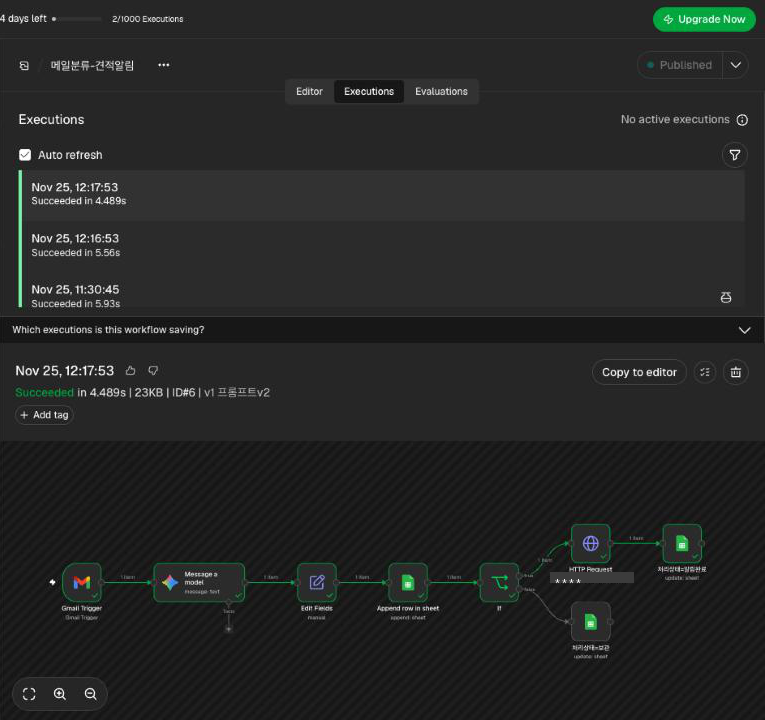
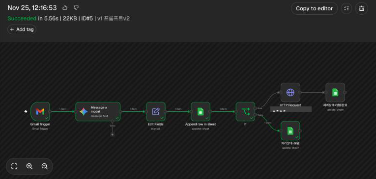
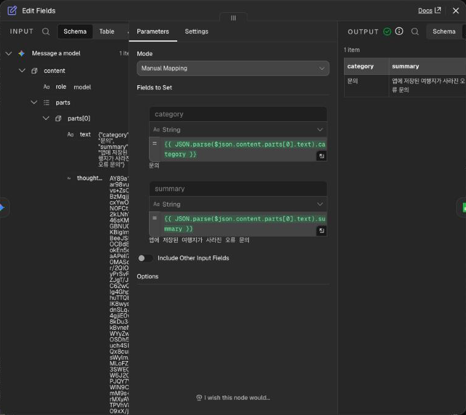

# 비교 분석 보고서 (산출물 1)

> 같은 자동화 워크플로우를 노코드 도구 2개로 구현하고 비교한 기록
> ⚠️ 캡처 속 API 키, 토큰, 비밀번호는 `****`로 가리고, 계정 이메일은 일부를 가린다 (예: `ab***@gmail.com`)

---

## 1. 사용한 도구

| 구분 | 도구 이름 | 요금제 | 사용 기간 |
|---|---|---|---|
| 도구 A | Make | 무료(Free) — 월 1,000 크레딧, 활성 시나리오 2개, 최소 실행 간격 15분 | 2026-11-24 ~ 2026-11-25 |
| 도구 B | n8n 클라우드 | 14일 무료 체험(Pro 기능, 실행 1,000회) — 상시 무료 요금제는 없음 | 2026-11-25 ~ |

> Zapier도 후보였지만 무료 요금제가 2단계 Zap만 허용하고 필터·분기(Paths)를 막아 "트리거 1 + 액션 2 + 분기 1"을 만들 수 없어 제외했다.

## 2. 비교에 사용한 워크플로우

두 도구 모두 아래 네 가지를 **똑같이** 설정했다.

| 항목 | 내용 |
|---|---|
| 시작 이벤트 (트리거) | Gmail 받은편지함에 제목에 `MMJTEST`가 들어간 새 메일이 도착함 (검색식 `in:inbox subject:MMJTEST`) |
| 핵심 액션 | Gemini 3.8 Flash가 같은 프롬프트(v2)로 메일을 문의 / 견적 / 광고로 분류하고 한 줄로 요약함 |
| 분기 조건 | 분류 결과가 "견적"인 메일과 나머지 메일로 나눔 |
| 최종 결과 | 모든 메일은 시트에 한 줄 추가, "견적"이면 팀 채널에 알림, 나머지는 처리상태를 "보관"으로 둠 |

> 워크플로우 상세, AI 프롬프트, 시트 구조는 [설계문서.md](설계문서.md) 4장과 같다. 테스트 데이터는 [test-data/테스트메일.md](test-data/테스트메일.md).

## 3. 연결한 계정과 외부 서비스

| 도구 | 연결한 계정 (일부 가림) | 외부 서비스 | 허용한 권한 범위 |
|---|---|---|---|
| 도구 A (Make) | sy\*\*\*07@gmail.com | Gmail (연결 1개) | Google 로그인 후 권한 화면에서 허용한 메일 읽기 범위 |
| 도구 A (Make) | sy\*\*\*07@gmail.com | Google Sheets (연결 1개, Gmail과 별도) | 스프레드시트 읽기·쓰기 |
| 도구 A (Make) | 내 Google AI Studio API 키 (`****`) | Google Gemini | API 호출 |
| 도구 A (Make) | — | Discord 채널 웹훅 (`****`) | 해당 채널에 메시지 보내기만 가능 |
| 도구 B (n8n) | sy\*\*\*07@gmail.com | Gmail (OAuth 자격 증명) | 메일 읽기 |
| 도구 B (n8n) | sy\*\*\*07@gmail.com | Google Sheets (OAuth 자격 증명, Gmail과 별도) | 스프레드시트 읽기·쓰기 |
| 도구 B (n8n) | n8n Gateway credits (API 키 입력 없음) | Google Gemini | n8n이 대신 호출, 무료 $2 크레딧에서 차감 |
| 도구 B (n8n) | — | Discord 채널 웹훅 (`****`) | 해당 채널에 메시지 보내기만 가능 |

## 4. 구현 과정 요약

### 4-1. 도구 A
도구 A = **Make** (무료 요금제)

1. 시나리오 「메일분류-견적알림」을 만들고 Gmail **Watch emails**를 트리거로 넣음. 기본 "Sign in with Google"로 바로 연결됨
2. 트리거 Filter type을 Gmail filter로 바꾸고 검색식 `in:inbox subject:MMJTEST`로 테스트 메일만 가져오게 함 (처음엔 받은편지함 전체를 봐서 실제 메일이 처리됨)
3. **Google Gemini AI → Generate a response**(내 API 키, Gemini 3.8 Flash)에 분류 프롬프트를 넣고 제목·본문을 매핑
4. **JSON → Parse JSON**으로 AI 응답을 `Category`, `Summary`로 나눔
5. **Google Sheets → Add a Row**로 받은시각·보낸사람·제목·분류·요약 기록
6. **Router**로 「견적」(`Category = 견적`) / 「나머지」(`Category ≠ 견적`) 경로를 나눔
7. 「견적」: **HTTP → Make a request**로 Discord 웹훅에 알림 → **Update a Row**로 처리상태 `알림완료`
8. 「나머지」: **Update a Row**로 처리상태 `보관`
9. Run once로 테스트. 「나머지」의 fallback 설정이 저장되지 않아 견적 메일도 두 경로를 다 타는 문제를 발견하고, 조건을 직접 넣어 고침

**구성 화면** (웹훅 주소는 가림)

**실행 결과** (테스트 메일 2통: 견적 1 → 「견적」 경로, 문의 1 → 「나머지」 경로)

### 4-2. 도구 B
도구 B = **n8n 클라우드** (14일 무료 체험, 실행 1,000회)

1. 워크플로우 「메일분류-견적알림」을 만들고 **Gmail Trigger(On message received)**를 넣음. Search 필터 `in:inbox subject:MMJTEST`, 1분마다 확인, Simplify를 꺼서 본문 전체를 받음
2. **Google Gemini → Message a model**(Gemini 3.8 Flash). 자격 증명 기본값이 n8n Gateway credits라 API 키 없이 실행됨. 프롬프트는 Make v2와 같은 문구를 Expression으로 넣고 `{{ $json.subject }}`, `{{ $json.text }}`로 제목·본문을 넣음
3. 전용 JSON 파싱 블록이 없어 **Edit Fields(Set)**에서 `JSON.parse(...)` 식으로 `category`, `summary`를 꺼냄
4. **Google Sheets → Append row**로 「메일분류」 문서의 `n8n` 탭에 기록 (Gmail과 별도로 Sheets 로그인 한 번 더). 행 갱신용으로 메일ID 열을 추가
5. **If** 노드로 `category = 견적` 분기 — true/false 출구가 노드에 바로 달림
6. true: **HTTP Request**(POST, JSON 본문 content)로 Discord 알림 → **Update row**(메일ID로 찾아 처리상태 `알림완료`)
7. false: **Update row**(처리상태 `보관`)
8. Execute workflow로 수동 확인 후 **Publish**로 자동 실행을 켜고, 테스트 메일 2통이 각각 자동 실행된 것을 확인한 뒤 Unpublish

**구성 화면** (웹훅 주소는 가림)

**실행 결과** — 12:16:53 문의 메일은 false(보관), 12:17:53 견적 메일은 true(Discord 알림 → 알림완료)로 자동 실행됨

 (보낸 사람 메일 주소는 가림)

## 5. 비교 항목 (5개 이상)

같은 워크플로우를 두 도구로 직접 만들면서 확인한 차이다. (요금·한도는 2026-11-25 기준)

| 비교 항목 | 도구 A: Make | 도구 B: n8n |
|---|---|---|
| 화면 구성 | 밝은 캔버스에 원형 모듈을 점선으로 이음. 모듈을 누르면 작은 설정 창이 뜸 | 어두운 캔버스에 사각 노드를 선으로 이음. 노드를 열면 입력 · 설정 · 출력이 한 화면 3단으로 보임 |
| 트리거 확인 주기 | 무료 요금제 최소 15분. 새 메일이 없을 때의 확인 실행은 크레딧 0 | 기본 1분. 메일을 보내고 1분 안에 실행됨 |
| Gmail 범위 좁히기 | Filter type을 Simple → Gmail filter로 바꿔야 검색식 입력 칸이 나옴 | 필터 메뉴에 Search가 바로 있음 |
| 생성형 AI 블록 (API 키) | Google Gemini AI 모듈에 **내 API 키**를 넣어야 함 (키 없이 쓰는 Simple text prompt는 Make 크레딧 차감) | Google Gemini 노드 기본값이 **n8n Gateway credits**($2 무료)라 키 없이 바로 실행됨 |
| AI 결과(JSON) 나누기 | 전용 **Parse JSON** 모듈에 샘플로 데이터 구조만 만들면 됨 (코드 없음) | 전용 노드가 없어 Edit Fields에 `JSON.parse(...)` **식(JavaScript)을 직접 씀** |
| 분기 설정 방식 | **Router** + 연결선마다 필터. "나머지" 경로의 fallback 설정이 저장되지 않아 견적 메일도 두 경로를 다 탄 문제가 있었고, `≠ 견적` 조건을 직접 넣어 해결 | **If** 노드 하나에 true / false 출구가 달려 "나머지"를 따로 만들 필요가 없음 |
| 앞 단계 값 넣는 방식 | 매핑 패널에서 값을 클릭하면 알약 모양으로 들어감 | `{{ $json.subject }}` 같은 식을 쓰거나 끌어다 놓음. 입력하면 결과 미리보기가 바로 보임 |
| 시트 행 갱신 | 행 추가 모듈이 돌려준 **행 번호**로 바로 갱신 | 행 번호를 쓰지 않고 **어느 열 값으로 찾을지** 정해야 함 → 메일ID 열을 추가 |
| Google 계정 연결 | Gmail, Sheets 연결을 각각 만듦 ("Sign in with Google" 2번) | Gmail, Sheets 자격 증명을 각각 만듦 ("Sign in with Google" 2번) — 같음 |
| 실행 기록 확인 | History에 Schedule / Manual 실행과 사용 크레딧이 줄마다 나옴. 실행을 열면 모듈별 말풍선에서 operation별 입력·출력을 넘겨 봄 | Executions에 실행마다 캔버스가 그대로 나오고, 지나간 경로가 초록색으로 표시됨. 노드를 열면 입력·출력 표가 나옴 |
| 여러 메일 처리 | 한 번 실행에서 메일 2통을 묶음(bundle)으로 차례로 처리 | 이번 테스트에서는 메일이 1분 간격으로 들어와 메일마다 실행이 따로 생김 |
| 무료 사용량 단위 | **크레딧**: 모듈이 일할 때마다 1 (메일 1통 ≈ 4~5 크레딧, Router는 0). 이번 실습에서 총 48 크레딧 사용 | **실행 횟수**: 워크플로우 1회 = 1 (노드 수와 무관). 자동 실행 2회 사용, 체험은 14일 뒤 끝남 |
| 자동 실행 켜기 | 상단 Active 토글 + 간격 선택 | **Publish**로 버전 이름을 붙여 배포. 끌 때는 Unpublish |
| 잘못된 경고 | 저장·실행 때마다 JSON 모듈에 "데이터를 안 쓴다"는 경고가 떴지만 실제로는 정상 | 특별한 오류 없음 |

## 6. 도구별 장단점

### 도구 A: Make
- 장점:
  - JSON 나누기, 행 번호 받기 같은 일을 **전용 모듈**로 처리해 코드를 한 줄도 쓰지 않았다
  - 매핑 패널에서 값을 클릭해 넣어 식 문법을 몰라도 된다
  - History에 실행마다 크레딧이 보여 비용을 바로 가늠할 수 있다
- 단점:
  - 무료 요금제는 최소 15분 간격이라 알림이 늦다
  - Router의 fallback 설정이 저장되지 않는 등 화면과 실제 설정이 달라 한 번 더 확인해야 했다
  - 생성형 AI를 쓰려면 API 키를 따로 발급해 넣어야 한다
  - 모듈마다 크레딧이 나가 단계가 많을수록 무료 한도가 빨리 준다

### 도구 B: n8n
- 장점:
  - 1분 간격으로 바로 실행된다
  - If 노드 하나로 참/거짓이 갈려 분기 구조가 한눈에 보인다
  - 노드 설정 창에서 입력 · 설정 · 출력을 함께 보며 식 결과를 미리 확인할 수 있다
  - Gateway credits로 API 키 없이 AI를 바로 써 볼 수 있다
  - 실행 횟수 단위라 노드를 많이 써도 한도가 빨리 줄지 않는다
- 단점:
  - JSON 나누기에 `JSON.parse` 같은 식을 직접 써야 해 코드를 전혀 모르면 막힌다
  - 시트 행 갱신에 "찾을 열"이 필요해 시트 구조를 바꿔야 했다
  - 클라우드는 상시 무료 요금제가 없고 14일 체험 뒤에는 유료다

## 7. 어떤 상황에 적합한가 (직접 작성한 의견)

- **도구 A(Make)가 어울리는 상황:** 코드를 모르는 담당자가 직접 만들고 고쳐야 하는 사내 반복 업무. 처리 건수가 하루 수십 통 수준이고 15분 정도 늦게 처리돼도 괜찮은 일(메일 분류·시트 정리, 주간 보고 취합 등)에 맞다. 전용 모듈이 많아 JSON 나누기, 행 번호 받기 같은 일을 코드 없이 끝낼 수 있고, 무료 요금제가 계속 유지돼 작은 팀이 비용 없이 오래 쓸 수 있다.
- **도구 B(n8n)가 어울리는 상황:** 몇 분 안에 반응해야 하는 알림(긴급 문의, 장애 알림)이나, 단계가 많아 모듈마다 크레딧이 나가는 방식이 부담되는 흐름. 짧은 JavaScript 식을 쓸 수 있는 사람이 있고, 체험 뒤 유료 요금제를 쓰거나 직접 서버에 설치(셀프 호스팅)할 수 있는 팀에 맞다. If 노드와 실행 화면이 한눈에 보여 분기가 많은 워크플로우를 점검하기도 쉽다.

## 8. 유료 기능 사용 여부

- [x] 유료 기능을 쓰지 않았음
  - Make: 무료 요금제 안에서 구현 (사용 48 크레딧 / 월 1,000)
  - n8n: 14일 무료 체험 기간 안에서 구현 (자동 실행 2회 / 1,000회). Gemini는 무료로 주는 Gateway credits $2에서 차감
- [ ] 유료 기능을 썼음
  - n8n 클라우드는 체험이 끝나면 유료 요금제가 필요하다. 계속 무료로 쓰려면 직접 설치(셀프 호스팅)해야 한다
