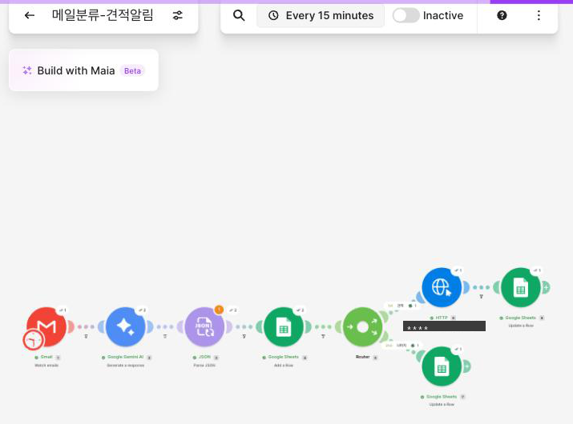
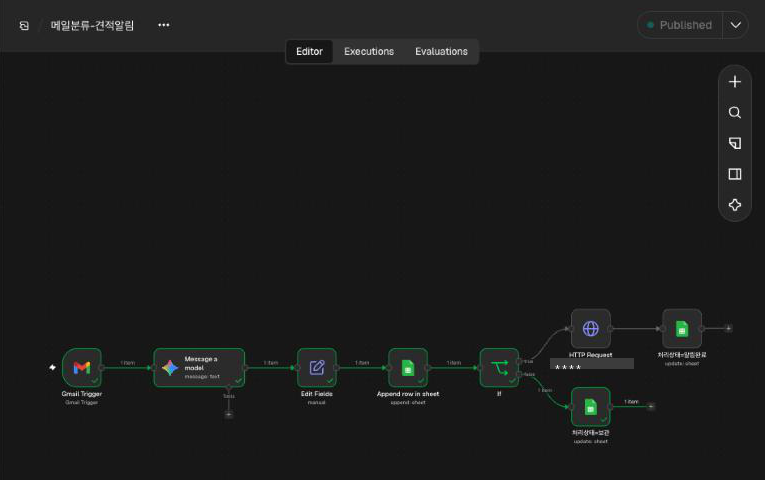
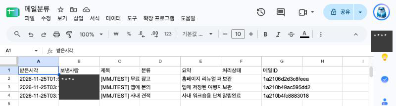

# 비교 분석 보고서 (산출물 1)

> 같은 자동화 워크플로우를 노코드 도구 2개로 구현하고 비교한 기록
> ⚠️ 캡처 속 API 키, 토큰, 비밀번호는 `****`로 가리고, 계정 이메일은 일부를 가린다 (예: `ab***@gmail.com`)

---

## 1. 사용한 도구

| 구분 | 도구 이름 | 요금제 | 사용 기간 |
|---|---|---|---|
| 도구 A | (예: Make) | 무료 | 2026-11-__ ~ |
| 도구 B | (예: Zapier) | 무료 | 2026-11-__ ~ |

## 2. 비교에 사용한 워크플로우

두 도구 모두 아래 네 가지를 **똑같이** 설정했다.

| 항목 | 내용 |
|---|---|
| 시작 이벤트 (트리거) | (예: 테스트 메일함에 새 메일이 도착함) |
| 핵심 액션 | (예: 생성형 AI가 메일을 문의 / 견적 / 광고로 분류함) |
| 분기 조건 | (예: 분류 결과가 "견적"인 메일과 나머지 메일로 나눔) |
| 최종 결과 | (예: 모든 메일은 시트에 한 줄 추가, "견적"이면 팀 채널에도 알림) |

## 3. 연결한 계정과 외부 서비스

| 도구 | 연결한 계정 (일부 가림) | 외부 서비스 | 허용한 권한 범위 |
|---|---|---|---|
| 도구 A | ab***@gmail.com | Gmail, Google Sheets, Slack | (예: 메일 읽기, 시트 쓰기) |
| 도구 B | ab***@gmail.com | Gmail, Google Sheets, Slack | |

## 4. 구현 과정 요약

### 4-1. 도구 A
1. (예: 시나리오를 새로 만들고 Gmail 모듈을 트리거로 추가함)
2.
3.

**구성 화면**

**실행 결과**

### 4-2. 도구 B
1.
2.
3.

**구성 화면**

**실행 결과**

## 5. 비교 항목 (5개 이상)

| 비교 항목 | 도구 A | 도구 B |
|---|---|---|
| 화면 구성 | | |
| 분기 설정 방식 | | |
| 생성형 AI 블록 사용법 (API 키 필요 여부) | | |
| 무료 사용량 (실행 한도 / 단위) | | |
| 실행 기록 확인 | | |
| 연동 서비스 수 / 찾기 쉬움 | | |
| (추가 항목) | | |

## 6. 도구별 장단점

### 도구 A
- 장점:
- 단점:

### 도구 B
- 장점:
- 단점:

## 7. 어떤 상황에 적합한가 (직접 작성한 의견)

- **도구 A가 어울리는 상황:**
- **도구 B가 어울리는 상황:**

## 8. 유료 기능 사용 여부

- [ ] 유료 기능을 쓰지 않았음
- [ ] 유료 기능을 썼음 → 아래 작성
  - 사용한 기능:
  - 필요했던 이유:
  - 무료로는 어디까지 되는지:
