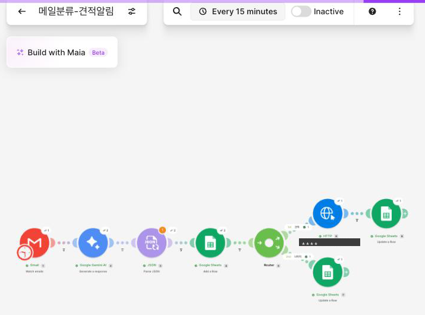
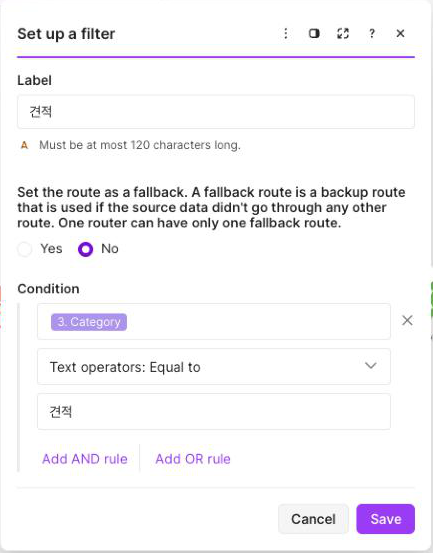
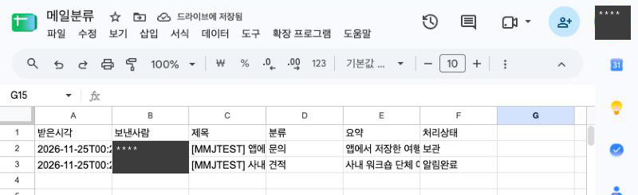
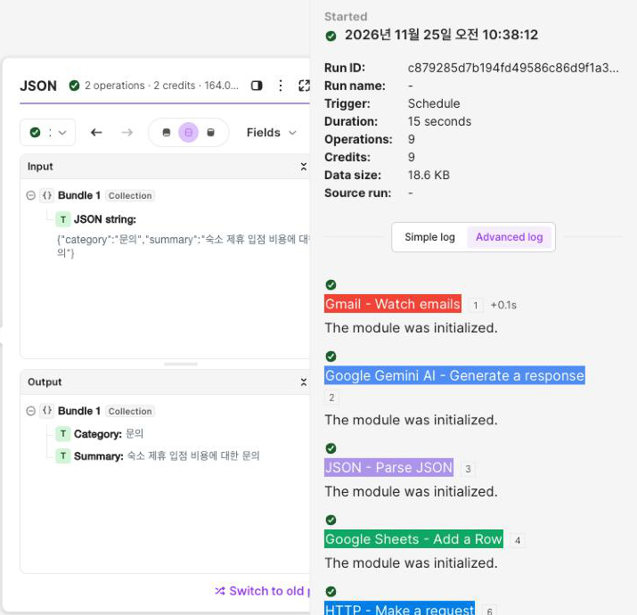

# 설계 문서 (산출물 2) — 자유 주제 자동화

> ⚠️ 캡처 속 API 키, 토큰, 비밀번호는 `****`로 가리고, 계정 이메일은 일부를 가린다
> ⚠️ 실제 업무 데이터나 개인정보는 쓰지 않고 테스트 데이터만 사용한다

---

## 1. 자동화 대상 업무 정의

머물지도(가상 여행지 추천 서비스) 대표 메일함에 새 메일이 들어오면 AI가 문의·견적·광고로 분류하고 한 줄로 요약해 시트에 기록하며, 견적 요청 메일은 팀 채널에 바로 알린다.

- 처리 대상: [test-data/테스트메일.md](test-data/테스트메일.md)의 가상 메일 6통 (실제 업무 데이터·개인정보 없음)

## 2. 도구 선정

- **선정한 도구:**
- **선정 이유 (직접 작성):**

| 선정 근거로 삼은 비교 항목 (2개 이상) | 확인한 차이 | 이 업무에 왜 중요한가 |
|---|---|---|
| 1. | | |
| 2. | | |

## 3. 연결한 계정과 외부 서비스

| 연결한 계정 (일부 가림) | 외부 서비스 | 허용한 권한 범위 |
|---|---|---|
| ab***@gmail.com | | |

## 4. 워크플로우 설계

```
[자유 주제] 대표 메일함 새 메일 분류·기록·견적 알림

트리거:
  테스트용 Gmail 받은편지함에 새 메일이 도착함

액션 1 (생성형 AI):
  메일 제목과 본문을 읽고 문의 / 견적 / 광고 중 하나로 분류하고, 한 줄로 요약함
  (결과는 JSON: {"category": "...", "summary": "..."})

액션 2:
  받은 시각, 보낸 사람, 제목, AI 분류, AI 요약을 Google Sheets 「메일분류」 시트에 한 줄 추가함

조건 분기:
  AI 분류 결과(category)가 "견적"인지 아닌지로 나눔

액션 3 (경로 A: 견적):
  팀 채널(Discord)에 "견적 요청 도착" 알림을 보냄 (제목, AI 요약, 받은 시각 포함)
  → 방금 추가한 시트 행의 '처리상태' 칸을 "알림완료"로 바꿈

액션 4 (경로 B: 문의·광고):
  알림 없이 방금 추가한 시트 행의 '처리상태' 칸을 "보관"으로 바꿈
```

### 시트 구조 (Google Sheets 「메일분류」)

| A 받은시각 | B 보낸사람 | C 제목 | D 분류 | E 요약 | F 처리상태 |
|---|---|---|---|---|---|
| (트리거 값) | (트리거 값) | (트리거 값) | (AI 결과) | (AI 결과) | 경로 A: `알림완료` / 경로 B: `보관` |

### 구성 요소 설명

| 구분 | 내용 | 비고 |
|---|---|---|
| 트리거 | | 수동 개입 없이 자동 실행되도록 설정함 (예: 15분마다 확인 / 즉시) |
| 액션 1 (생성형 AI) | | 사용한 AI 모듈 / 모델: |
| 액션 2 | | |
| 조건 분기 | | **분기 기준:** |
| 경로 A 액션 | | |
| 경로 B 액션 | | |

### 생성형 AI 액션에 넣은 프롬프트

> 초안(v1). 도구에 넣고 실행해 본 뒤 실제로 넣은 판으로 바꾼다. 고친 판은 보너스 1 비교에 쓴다.

```
너는 여행지 추천 서비스 '머물지도'의 대표 메일함을 정리하는 담당자다.
아래 메일을 읽고 다음 셋 중 하나로 분류하고, 핵심을 한 줄(40자 이내)로 요약해라.

- 문의: 서비스 사용법, 오류, 기능, 요금 등을 묻는 메일
- 견적: 우리에게 비용 산정이나 견적서를 요청하는 메일
- 광고: 상품·서비스를 홍보하거나 판매하려는 메일

반드시 아래 JSON 한 줄만 출력해라. 설명, 코드블록 기호(```)는 붙이지 마라.
{"category": "문의|견적|광고 중 하나", "summary": "한 줄 요약"}

[메일 제목]
{{제목}}

[메일 본문]
{{본문}}
```

## 5. 구현 화면

Make 시나리오 「메일분류-견적알림」. Gmail → Google Gemini AI → JSON → Google Sheets(행 추가) → Router → 「견적」(HTTP로 Discord 알림 → 시트 갱신) / 「나머지」(시트 갱신). 모듈 위 숫자는 2026-11-25 테스트 메일 2통 실행에서 처리한 건수다. (웹훅 주소는 `****`로 가림)



「견적」 경로 필터: `Category`(AI 분류 결과)가 `견적`과 같을 때만 통과한다. 「나머지」 경로는 `Category`가 `견적`과 같지 않을 때 통과한다.



## 6. 실행 결과

### 6-1. AI 결과가 다음 단계로 넘어간 화면
Gemini가 만든 JSON 문자열(Input)이 JSON 모듈에서 `Category: 견적`, `Summary: 사내 워크숍 단체 여행 코스 견적 요청`(Output)으로 나뉘어 다음 단계(시트 기록, Router 필터)로 넘어간다.


### 6-2. 분기 경로 A 실행 결과
견적 메일이 「견적」 경로로 가서 HTTP 모듈이 Discord 웹훅에 알림을 보냈다. 응답 코드 204 = 전송 성공. (웹훅 주소는 가림)


### 6-3. 분기 경로 B 실행 결과
문의 메일이 「나머지」 경로로 가서 시트 8행의 처리상태(F열)를 `보관`으로 바꿨다.


### 6-3-1. 시트 최종 결과
경로 B 메일은 `보관`, 경로 A 메일은 `알림완료`로 기록됐다. (보낸 사람 메일 주소는 가림)



### 6-4. 트리거로 자동 실행된 실행 이력
10:23:10에 스케줄을 켠(Scenario activated) 뒤, 아무 버튼도 누르지 않은 상태에서 10:23:12와 10:38:12에 **Schedule** 실행이 기록됐다. 10:23 실행은 새 메일이 없어 확인만 하고 끝났고(크레딧 0), 10:38 실행이 그 사이 도착한 테스트 메일 2통을 처리했다(9 operations, 9 credits). 그 아래 9시대 기록은 테스트 때 직접 누른 Manual run이다.


---
---

## 📝 작업 기록

> 작업 하나를 한 항목으로 적고, 무엇을 어떻게 했는지가 드러나게 쓴다.
> 워크플로우를 수정한 기록을 1건 이상 남긴다 (`[수정]` 표시).

| # | 날짜 | 작업 내용 |
|---|---|---|
| 1 | 2026-11-21 | 미션 PDF를 읽고 AI에게 진행 순서를 단계별로 물어봄 |
| 2 | 2026-11-21 | AI에게 요청해 제출 문서 3개(비교분석보고서, 설계문서, 한계기록서)의 템플릿 파일을 만듦 |
| 3 | 2026-11-24 | AI에게 진행 단계를 다시 제안받아, 프로젝트 1과 2를 같은 메일 분류 워크플로우로 묶어 진행하기로 정함 |
| 4 | 2026-11-24 | Make·n8n·Zapier 무료 요금제를 검색해 비교함. Zapier 무료는 2단계 Zap만 되고 분기(Paths)·필터가 막혀 있어 후보에서 뺌 |
| 5 | 2026-11-24 | 머물지도 대표 메일함을 가정한 가상 테스트 메일 6통(문의 2, 견적 2, 광고 2)을 만들어 test-data/테스트메일.md에 정리함 |
| 6 | 2026-11-24 | 워크플로우 설계(트리거·AI 분류·시트 기록·견적 분기)와 시트 열 구조, AI 프롬프트 초안 v1을 설계 문서에 적음 |
| 7 | 2026-11-24 | Make 구현 순서를 AI에게 받아 진행가이드.md에 정리함. 개인 Gmail은 Make에서 커스텀 OAuth 클라이언트가 필요하다는 점과, 무료 크레딧을 아끼려 스케줄은 캡처할 때만 켜기로 한 점을 확인함 |
| 8 | 2026-11-25 | Make에 「메일분류-견적알림」 시나리오를 만들고 Gmail Watch emails 트리거를 넣음. 문서상 커스텀 OAuth가 필요할 줄 알았는데 Gmail 앱이 Verified로 바뀌어 기본 "Sign in with Google"로 바로 연결됨. 시작 지점은 From now on, 한 번에 가져올 메일은 3통으로 설정 |
| 9 | 2026-11-25 | Gemini 모듈은 Make 크레딧을 쓰는 "Simple text prompt" 대신 내 API 키를 쓰는 "Generate a response"를 고름 |
| 10 | 2026-11-25 | Gemini 모듈에 Gemini 3.8 Flash를 고르고 분류 프롬프트 v1을 넣은 뒤 메일 제목(Subject)·본문(Full text body)을 매핑함 |
| 11 | 2026-11-25 | [수정] 프롬프트를 한 번에 붙여 넣었더니 줄바꿈이 사라져 분류 기준이 한 줄로 붙음. 내용을 모두 지우고 Shift+Enter로 줄을 나눠 다시 입력함 |
| 12 | 2026-11-25 | JSON Parse JSON 모듈을 넣고, 샘플 `{"category","summary"}`로 데이터 구조 「메일분류결과」를 만들어 Gemini의 Result를 연결함 |
| 13 | 2026-11-25 | Google Sheets Add a Row 모듈을 추가함. 연결한 드라이브에 「메일분류」 시트가 없어서 새 스프레드시트를 만들고 1행에 받은시각·보낸사람·제목·분류·요약·처리상태 머리글을 넣음 |
| 14 | 2026-11-25 | Add a Row 열 매핑: 받은시각←Date, 보낸사람←From(email), 제목←Subject, 분류←category, 요약←summary. 처리상태는 비워 둠 |
| 15 | 2026-11-25 | Router를 넣고 1번 경로 「견적」은 필터 category = 견적(텍스트 같음), 2번 경로 「나머지」는 조건 없이 fallback route로 설정함 |
| 16 | 2026-11-25 | 경로 B에 Sheets Update a Row를 넣어 Add a Row가 돌려준 Row Number 행의 처리상태를 "보관"으로 바꾸게 함 |
| 17 | 2026-11-25 | 경로 A에 HTTP Make a request(POST, JSON)를 넣고, 값이 자동 이스케이프되도록 데이터 구조 「Discord알림」(content 한 칸)으로 본문을 만듦. 알림 문구에 제목·AI 요약·받은 시각을 넣음 |
| 18 | 2026-11-25 | [수정] 알림 본문의 요약 자리에 매핑 패널이 밀려 From(email)이 잘못 들어감 → 지우고 Summary로 바꿔 넣음 |
| 19 | 2026-11-25 | Discord 채널 웹훅을 만들어 HTTP 모듈 URL에 넣음(값은 문서에 남기지 않음). 경로 A 끝에 Sheets Update a Row를 붙여 처리상태를 "알림완료"로 바꾸게 함 |
| 20 | 2026-11-25 | 저장할 때마다 JSON 모듈에 "생성한 데이터를 쓰지 않는다"는 경고가 뜸. 실제로는 Category·Summary를 시트와 필터에서 쓰고 있어 일단 Save anyway로 저장하고 실행 결과로 확인하기로 함 |
| 21 | 2026-11-25 | (#20 확인) 실행해 보니 Category·Summary가 시트와 Router로 정상 전달됨 → JSON 모듈 경고는 잘못된 경고였음 |
| 22 | 2026-11-25 | 테스트 메일 2통을 보낸 뒤 Run once 실행. 오류 없이 끝났지만 Gmail이 실제 계정에 연결돼 있어 받은편지함의 실제 메일 3통(보안 알림, 신용정보 알림, 교육 안내)이 처리됨. 모두 문의/광고로 분류돼 경로 B로 감. 실행을 멈춤 |
| 23 | 2026-11-25 | [수정] 실제 메일이 다시 처리되지 않도록 Gmail 연결을 테스트 계정으로 바꾸려고 새 연결을 시작했다가, 원래 계정을 쓰기로 하고 취소함 |
| 24 | 2026-11-25 | [수정] 트리거 Filter type을 Simple filter → Gmail filter로 바꾸고 검색식 `in:inbox subject:MMJTEST`를 넣어, 제목에 MMJTEST 태그가 붙은 테스트 메일만 가져오게 함. 테스트 메일 6통 제목 앞에 [MMJTEST]를 붙임 |
| 25 | 2026-11-25 | 태그를 붙인 짧은 확인용 메일 2통으로 Run once 실행. 실제 메일은 하나도 걸리지 않고 태그 메일 2통만 처리됨(검색식 동작 확인). 본문이 거의 없어 AI가 둘 다 "문의"로 분류해 경로 B로 감 |
| 26 | 2026-11-25 | 테스트 메일 2(견적)를 본문까지 보내고 Run once. Gemini가 `{"category":"견적","summary":"강릉 1박 2일 사내 워크숍 25인 맞춤 코스 견적 요청"}`을 만들었고, 경로 A의 HTTP가 Discord에 알림을 보냄(응답 204) |
| 27 | 2026-11-25 | 그런데 시트 7행(견적 메일)의 처리상태가 "알림완료"가 아니라 "보관"으로 남음. 확인해 보니 「나머지」 경로의 fallback 설정이 저장되지 않아(No) 조건 없는 경로가 되어, 견적 메일도 경로 B까지 지나가 알림완료를 보관으로 덮어씀 |
| 28 | 2026-11-25 | [수정] 「나머지」 경로에 조건 `Category 같지 않음 견적`을 직접 넣어, 견적이 아닌 메일만 지나가게 고침 |
| 29 | 2026-11-25 | 수정 후 테스트 메일 1(문의)·2(견적)를 다시 보내 Run once. 경로 A 1건·경로 B 1건으로 갈림. 시트 8행(문의)=보관, 9행(견적)=알림완료로 기록돼 분기 경로 두 개가 모두 정상 동작함을 확인 |
| 30 | 2026-11-25 | 시트에서 실제 메일·이전 테스트 기록(2~7행)을 지우고 최종 테스트 2행만 남김 |
| 31 | 2026-11-25 | Make 구성·실행 결과·AI 출력·경로 A(HTTP 204)·경로 B·시트 결과·필터 화면을 캡처해 images/에 저장. 웹훅 주소와 보낸 사람 메일 주소는 `****`로 가림 |
| 32 | 2026-11-25 | 자동 실행 확인을 위해 시나리오 스케줄을 켬(Active, 15분마다). 캡처를 받으면 크레딧을 아끼려고 다시 끌 예정 |
| 33 | 2026-11-25 | 테스트 메일 3(광고)·4(입점 비용 견적 요청)를 보내고 손대지 않음. 10:38 Schedule 실행이 2통을 자동 처리함. 새 메일이 없던 10:23 확인 실행은 크레딧 0으로 기록돼, "확인만 해도 크레딧이 나간다"던 처음 예상이 틀렸음을 확인. History 화면을 캡처하고 스케줄을 다시 끔 |
| 34 | 2026-11-25 | 메일 4(숙소 입점 비용을 견적서로 요청)를 Gemini가 `문의`로 분류해 「나머지」로 감 → Discord 알림이 가지 않음. 제목의 "문의드립니다"에 끌려간 것으로 보임. 보너스 1(프롬프트 수정 전후 비교)의 "수정 전" 사례로 캡처해 둠(images/bonus1-before.png) |

---

## 💬 프롬프트 기록 (3건 이상, 카테고리 표시)

> 카테고리: **자동화** (워크플로우 설계를 물어본 프롬프트, 코드를 요청한 프롬프트)

### 프롬프트 1
- **카테고리:** 자동화 (워크플로우 설계 질문)
- **보낸 곳:** Claude
- **내용:**
  > 미션을 진행하기 위해 뭐부터 해야 하는지 단계별로 알려줘.

### 프롬프트 2
- **카테고리:** 자동화 (워크플로우 설계 질문)
- **보낸 곳:** Claude
- **내용:**
  > 3-1파일의 미션을 폴더 안 내용물 기반으로 진행하고 싶어. 어떤 단계부터 어떻게 진행하면 좋을지 제안해줘

### 프롬프트 3
- **카테고리:** 자동화 (워크플로우 설계 질문)
- **보낸 곳:** Claude
- **내용:**
  > 0단계부터 시작 (→ 무료 요금제 확인, 테스트 메일, 시트 구조, AI 분류 프롬프트 초안을 받음)

### 프롬프트 4
- **카테고리:** 자동화 (코드 요청)
- **보낸 곳:**
- **내용:**
  > 

---

## (보너스) 1. 프롬프트 수정 전후 비교

| 구분 | 프롬프트 | 실행 결과 |
|---|---|---|
| 수정 전 | 분류 프롬프트 v1 (4장) | 메일 4 「[MMJTEST] 숙소 제휴 입점 비용 문의드립니다」(본문: 입점 비용과 수수료를 견적서로 받고 싶다) → `{"category":"문의","summary":"숙소 제휴 입점 비용에 대한 문의"}` → 「나머지」 경로, 알림 없음  |
| 수정 후 | | |

달라진 점:

## (보너스) 2. 오류 알림과 재시도 / 대체 경로

- 오류 알림 설정:
- 재시도 또는 대체 경로:
- 중복 실행 확인 결과 (시트 기록이나 알림이 두 번 생기지 않는지):
- 무료 한도 안에서 한 달 최대 실행 횟수:

## (보너스) 3. Google Apps Script 웹 앱 배포

- 배포 주소: (공개 범위: 나만 / 조직 / 모든 사용자)
- 다시 배포한 판 수:
- 앞 판으로 되돌린 적이 있는지:
