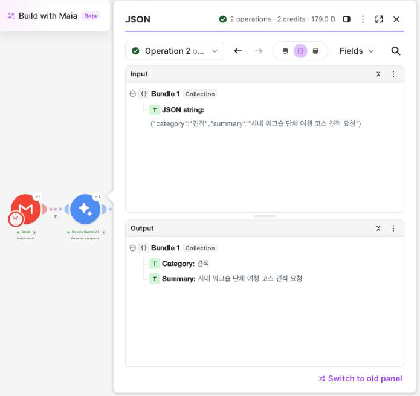
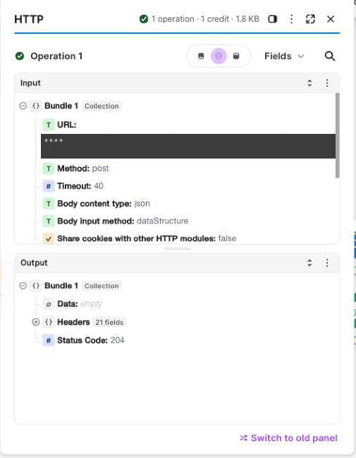
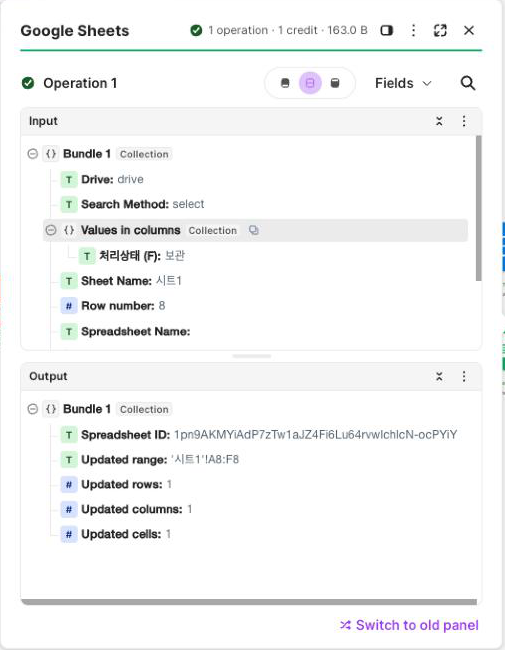
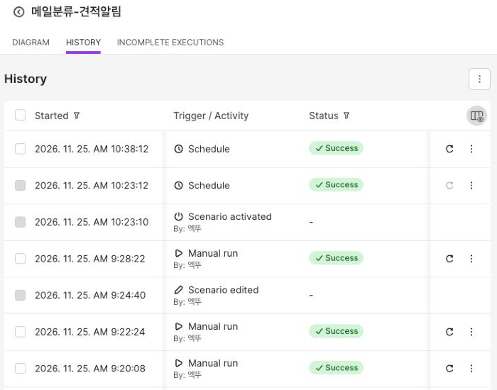

# 설계 문서 (산출물 2) — 자유 주제 자동화

> ⚠️ 캡처 속 API 키, 토큰, 비밀번호는 `****`로 가리고, 계정 이메일은 일부를 가린다
> ⚠️ 실제 업무 데이터나 개인정보는 쓰지 않고 테스트 데이터만 사용한다

---

## 1. 자동화 대상 업무 정의

> (한 문장으로) 예: 설문에 새 응답이 들어오면 AI가 한 문장으로 요약해 시트에 정리하고, 만족도가 낮은 응답은 담당자 채널에 알린다.

## 2. 도구 선정

- **선정한 도구:**
- **선정 이유 (직접 작성):**

| 선정 근거로 삼은 비교 항목 (2개 이상) | 확인한 차이 | 이 업무에 왜 중요한가 |
|---|---|---|
| 1. | | |
| 2. | | |

## 3. 연결한 계정과 외부 서비스

| 연결한 계정 (일부 가림) | 외부 서비스 | 허용한 권한 범위 |
|---|---|---|
| ab***@gmail.com | | |

## 4. 워크플로우 설계

```
[자유 주제] (업무 이름)

트리거:
  (무엇이 일어나면 시작되는지)

액션 1 (생성형 AI):
  (AI가 무엇을 만들거나 분류하는지)

액션 2:
  (AI 결과를 받아서 무엇을 하는지)

조건 분기:
  (어떤 기준으로 나누는지)

액션 3 (경로 A):
  

액션 4 (경로 B):
  
```

### 구성 요소 설명

| 구분 | 내용 | 비고 |
|---|---|---|
| 트리거 | | 수동 개입 없이 자동 실행되도록 설정함 (예: 15분마다 확인 / 즉시) |
| 액션 1 (생성형 AI) | | 사용한 AI 모듈 / 모델: |
| 액션 2 | | |
| 조건 분기 | | **분기 기준:** |
| 경로 A 액션 | | |
| 경로 B 액션 | | |

### 생성형 AI 액션에 넣은 프롬프트

```
(AI 액션에 실제로 넣은 프롬프트)
```

## 5. 구현 화면


## 6. 실행 결과

### 6-1. AI 결과가 다음 단계로 넘어간 화면


### 6-2. 분기 경로 A 실행 결과


### 6-3. 분기 경로 B 실행 결과


### 6-4. 트리거로 자동 실행된 실행 이력


---
---

## 📝 작업 기록

> 작업 하나를 한 항목으로 적고, 무엇을 어떻게 했는지가 드러나게 쓴다.
> 워크플로우를 수정한 기록을 1건 이상 남긴다 (`[수정]` 표시).

| # | 날짜 | 작업 내용 |
|---|---|---|
| 1 | 2026-11-21 | 미션 PDF를 읽고 AI에게 진행 순서를 단계별로 물어봄 |
| 2 | 2026-11-21 | AI에게 요청해 제출 문서 3개(비교분석보고서, 설계문서, 한계기록서)의 템플릿 파일을 만듦 |
| 3 | | |
| 4 | | [수정] |

---

## 💬 프롬프트 기록 (3건 이상, 카테고리 표시)

> 카테고리: **자동화** (워크플로우 설계를 물어본 프롬프트, 코드를 요청한 프롬프트)

### 프롬프트 1
- **카테고리:** 자동화 (워크플로우 설계 질문)
- **보낸 곳:** Claude
- **내용:**
  > 미션을 진행하기 위해 뭐부터 해야 하는지 단계별로 알려줘.

### 프롬프트 2
- **카테고리:** 자동화 (워크플로우 설계 질문)
- **보낸 곳:**
- **내용:**
  > 

### 프롬프트 3
- **카테고리:** 자동화 (코드 요청)
- **보낸 곳:**
- **내용:**
  > 

---

## (보너스) 1. 프롬프트 수정 전후 비교

| 구분 | 프롬프트 | 실행 결과 |
|---|---|---|
| 수정 전 | | |
| 수정 후 | | |

달라진 점:

## (보너스) 2. 오류 알림과 재시도 / 대체 경로

- 오류 알림 설정:
- 재시도 또는 대체 경로:
- 중복 실행 확인 결과 (시트 기록이나 알림이 두 번 생기지 않는지):
- 무료 한도 안에서 한 달 최대 실행 횟수:

## (보너스) 3. Google Apps Script 웹 앱 배포

- 배포 주소: (공개 범위: 나만 / 조직 / 모든 사용자)
- 다시 배포한 판 수:
- 앞 판으로 되돌린 적이 있는지:
