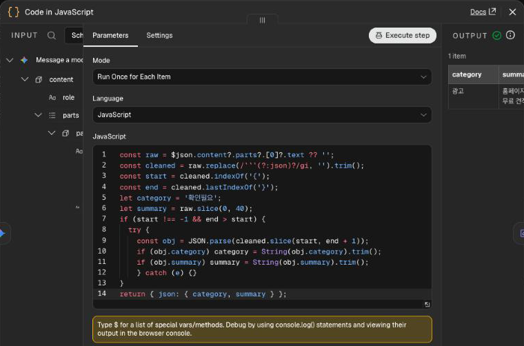
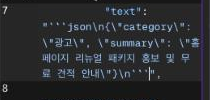
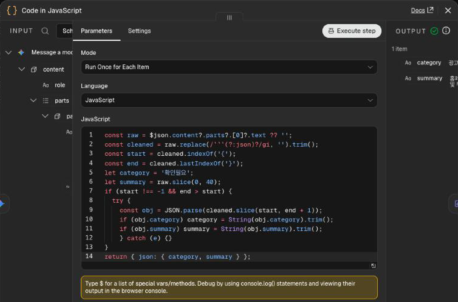

# 한계 기록서 (산출물 3)

> 노코드로 구현하지 못한 기능 3건과, 그중 1건을 코드로 시도한 기록
> ⚠️ 다른 방법으로 우회해 해결한 기능은 적지 않는다 (AI가 준 코드를 붙여 해결한 기능은 적어도 됨)
> ⚠️ 막힌 이유와 판단 내용은 직접 작성한다

> ✏️ 표시가 있는 칸은 직접 작성한다. "확인한 사실"은 실습 화면과 작업 기록(설계문서 #번호)에서 옮긴 근거이므로, 막힌 이유를 쓸 때 참고만 하고 최종 제출 전에 지워도 된다.

---

## [한계 1] Make 무료 요금제에서 견적 메일 즉시(1분 안에) 알리기

- **사용한 도구:** Make (무료 요금제)
- **하려던 것:** 견적 요청 메일이 들어오면 담당자가 바로 알 수 있도록, 메일이 도착하고 1분 안에 Discord 알림이 가게 하기
- **확인한 사실:**
  - 시나리오 스케줄 간격이 기본 15분이고, 무료 요금제의 최소 실행 간격이 15분이다 (설계문서 #32~33)
  - 실제로 10:23에 켠 뒤 다음 실행이 10:38이었다
  - Gmail Watch emails는 정해진 간격마다 확인하는 방식(polling)이라 메일이 도착한 순간에 실행되지 않는다
  - 같은 워크플로우를 n8n에서는 1분 간격으로 돌릴 수 있었다 (#43) — 도구를 바꾸면 되지만, Make 무료 안에서는 블록 설정으로 줄일 방법이 없었다
- **막힌 이유 (직접 작성):** ✏️
  

## [한계 2] n8n에서 AI 응답(JSON 글자)을 블록만으로 분류·요약 칸으로 나누기

- **사용한 도구:** n8n 클라우드
- **하려던 것:** Gemini가 돌려준 `{"category":"견적","summary":"..."}` 글자를 `category`, `summary` 두 값으로 나눠 시트 기록과 If 분기에 쓰기
- **확인한 사실:**
  - Make에는 전용 **Parse JSON** 모듈이 있어 샘플만 넣으면 됐다 (#12)
  - n8n에서는 같은 일을 하는 노드를 찾지 못해, Edit Fields에 `{{ JSON.parse($json.content.parts[0].text).category }}` 라는 JavaScript 식을 직접 써서 해결했다 (#39)
  - 즉 노코드 블록이 아니라 **코드(식)를 붙여서** 해결한 기능이다 → 한계 기록에 적을 수 있는 경우
  - AI가 응답을 ```` ```json ```` 코드블록으로 감싸면 이 식은 실패한다 (Make 프롬프트에 "코드블록 기호를 붙이지 마라"를 넣은 이유). 이번 실습에서는 감싸서 온 적이 없어 실패를 직접 보지는 못했다
- **막힌 이유 (직접 작성):** ✏️
  

## [한계 3] Discord 알림에서 "확인 완료"를 누르면 시트 처리상태를 바꾸기

- **사용한 도구:** Make, n8n 둘 다 검토
- **하려던 것:** 견적 알림 메시지에 버튼을 달아, 담당자가 누르면 시트의 처리상태가 `알림완료` → `처리완료`로 바뀌게 하기
- **확인한 사실:**
  - 두 도구 모두 Discord 알림을 **채널 웹훅 주소로 메시지를 보내는 HTTP 요청**으로 만들었다 (#17, #41). 웹훅은 보내기만 하는 한 방향 통로다
  - 버튼을 누른 결과를 받으려면 Discord 봇(애플리케이션)을 만들고, 누른 결과를 받아 줄 주소가 따로 있어야 한다
  - 이 부분은 실제로 만들어 보지 않고 검토 단계에서 포기했다
- **막힌 이유 (직접 작성):** ✏️
  

---

## [코드 시도] 한계 2를 대상으로 함

### 1. AI에게 요청한 내용

> 2026-11-25, Claude에게 보낸 요청
>
> n8n 워크플로우에서 Google Gemini 노드가 메일 분류 결과를 `{"category": "견적", "summary": "한 줄 요약"}` 같은 JSON 글자로 돌려줘. 이 글자는 `content.parts[0].text`에 들어 있어. 가끔 앞뒤에 ```json 코드블록 기호나 설명 문장이 붙어서 올 수도 있어. n8n Code 노드(JavaScript, Run Once for Each Item)에 붙여 넣을 코드로, 이 글자에서 category와 summary만 안전하게 꺼내서 다음 노드로 넘겨줘. JSON을 못 찾으면 category는 "확인필요", summary는 원문 앞 40자로 넣어줘.

### 2. 받은 코드

```javascript
// n8n Code 노드 (Mode: Run Once for Each Item)
// Gemini 응답 글자에서 category와 summary를 안전하게 꺼낸다
const raw = $json.content?.parts?.[0]?.text ?? '';

// 1) ```json ... ``` 같은 코드블록 기호와 앞뒤 공백 제거
const cleaned = raw.replace(/```(?:json)?/gi, '').trim();

// 2) 첫 번째 { 부터 마지막 } 까지만 잘라 앞뒤 설명 문장 제거
const start = cleaned.indexOf('{');
const end = cleaned.lastIndexOf('}');

// 3) 못 찾으면 쓸 기본값
let category = '확인필요';
let summary = raw.slice(0, 40);

if (start !== -1 && end > start) {
  try {
    const obj = JSON.parse(cleaned.slice(start, end + 1));
    if (obj.category) category = String(obj.category).trim();
    if (obj.summary) summary = String(obj.summary).trim();
  } catch (e) {
    // JSON 모양이 깨져 있으면 기본값을 그대로 둔다
  }
}

return { json: { category, summary } };
```

### 3. 코드를 넣은 위치

- n8n 「메일분류-견적알림」 워크플로우에서 **Message a model(Gemini)** 과 **Edit Fields** 사이의 연결선에 **Code in JavaScript** 노드를 새로 끼워 넣음
- Mode는 `Run Once for Each Item`, Language는 JavaScript
- 붙여 넣을 때 주석은 빼고 코드 줄만 넣었다 (편집기에 한 줄씩 입력)
- 코드가 `category`, `summary`를 바로 내보내므로, 뒤의 Edit Fields에 있던 `JSON.parse(...)` 식은 `{{ $json.category }}`, `{{ $json.summary }}`로 바꿈

### 4. 붙여 본 결과

1. **일반 응답** (Gemini가 JSON만 돌려준 실제 실행 결과, 메일 6) → Execute step 성공. 출력 `category: 광고`, `summary: 홈페이지 리뉴얼 패키지 홍보 및 무료 견적 안내`

   

2. **코드블록으로 감싼 응답** — Gemini 노드의 출력을 Edit Output(mock data)으로 고쳐, 글자 앞뒤에 ```` ```json\n ```` 과 ```` \n``` ```` 를 붙인 상태로 만듦

   

   → Code 노드를 다시 실행해도 성공. 출력 `category: 광고`, summary도 그대로 나옴. 기존 Edit Fields 식(`JSON.parse`만 쓰던 방식)이었다면 앞의 ```` ``` ```` 때문에 실패했을 입력이다

   

3. 확인 뒤 mock 데이터는 Unpin으로 지워 실제 실행에는 영향이 없게 함
4. 확인하지 못한 것: JSON 자체가 깨진 응답("확인필요"로 가는 경우)은 만들어 보지 않았다

### 5. 판단한 내용 (직접 작성)

✏️ (왜 이 기능을 골랐는지, 결과를 보고 무엇을 알게 됐는지)
