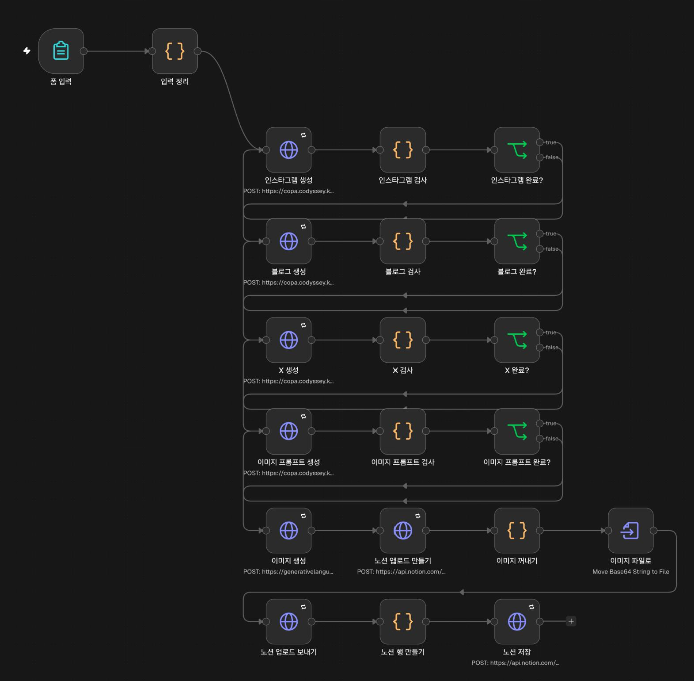

# 워크플로우 설명: AI 소셜 콘텐츠 자동 생성

주제 하나를 폼에 넣으면 n8n 워크플로우가 인스타그램 캡션, 블로그 글, X 게시글, 대표 이미지를 만든다. 결과는 노션 데이터베이스에 플랫폼별 행으로 저장한다.



- **도구:** n8n 클라우드 (체험판), 노드 21개
- **텍스트 생성:** Codyssey API (OpenAI 호환 중계 서버) `gpt-5.4-mini`
- **이미지 생성:** Gemini API `gemini-3.1-flash-image`, 정사각형 1:1
- **저장:** 노션 데이터베이스 "소셜 콘텐츠". 실행 1번에 4행(인스타그램·블로그·X·대표 이미지)을 만든다. [보기 전용 링크](https://uxdbea8.notion.site/4235468e9d9b80ee85b4d789b64dc63b)
- **가져오기 파일:** [워크플로우내보내기.json](워크플로우내보내기.json)

---

## 1. 전체 흐름

```text
[폼 입력] → [입력 정리]
   → 인스타그램:      [생성] → [검사] → [완료?] ─ 아니오 → [생성]으로 (최대 3번)
   → 블로그:          [생성] → [검사] → [완료?] ─ 아니오 → [생성]으로
   → X:               [생성] → [검사] → [완료?] ─ 아니오 → [생성]으로
   → 이미지 프롬프트: [생성] → [검사] → [완료?] ─ 아니오 → [생성]으로
   → [이미지 생성] → [노션 업로드 만들기] → [이미지 꺼내기] → [이미지 파일로] → [노션 업로드 보내기]
   → [노션 행 만들기] → [노션 저장]
```

화면에서는 플랫폼마다 한 줄씩 놓았다. 위에서 아래로 읽으면 실행 순서가 된다.

---

## 2. 노드별 역할

| # | 노드 | 종류 | 하는 일 |
| --- | --- | --- | --- |
| 1 | 폼 입력 | Form Trigger | 주제(필수), 보는 사람, 톤(친근/전문), 버전(A/B)을 받는다. |
| 2 | 입력 정리 | Code | 한국어 폼 항목을 영어 키로 바꾼다 (`topic` `audience` `tone` `version`). 빈 값은 기본값(20~30대 직장인, 친근, A)으로 채운다. 최종 프롬프트 4개에 값을 넣어 요청 본문 4개를 미리 만든다. |
| 3·6·9·12 | ○○ 생성 | HTTP Request | Codyssey `/v1/chat/completions`에 요청 본문을 보낸다. 네트워크 오류가 나면 3초 간격으로 3번까지 다시 보낸다. |
| 4·7·10·13 | ○○ 검사 | Code | 응답에서 JSON을 꺼내 기준을 검사한다 (아래 3절). `$runIndex`로 몇 번째 시도인지 센다. |
| 5·8·11·14 | ○○ 완료? | If | 통과했거나 3번째 시도면 다음 플랫폼으로 간다. 아니면 같은 줄의 생성 노드로 돌아간다. |
| 15 | 이미지 생성 | HTTP Request | 이미지 프롬프트(영어)를 Gemini에 보내 1:1 이미지를 받는다. |
| 16 | 노션 업로드 만들기 | HTTP Request | 노션 File Upload API 1단계: 업로드 자리를 만들고 ID를 받는다. |
| 17 | 이미지 꺼내기 | Code | Gemini 응답에서 base64 이미지와 형식(JPG/PNG)을 꺼내고 파일 이름을 정한다. |
| 18 | 이미지 파일로 | Convert to File | base64를 바이너리 파일로 바꾼다. |
| 19 | 노션 업로드 보내기 | HTTP Request | File Upload API 2단계: 파일을 multipart로 보낸다. |
| 20 | 노션 행 만들기 | Code | 플랫폼별 결과를 노션 페이지 요청 본문 4개로 만든다. 대표 이미지 행에 업로드 ID를 붙인다(3단계). |
| 21 | 노션 저장 | HTTP Request | 4개를 하나씩 `POST /v1/pages`로 저장한다. |

---

## 3. 검사 기준 (Code 노드)

검사 코드는 [tools/check.js](tools/check.js)의 "검사 함수" 구역을 Code 노드에 그대로 붙여 넣은 것이다. 로컬 시험과 n8n이 같은 코드로 검사한다.

| 플랫폼 | 기준 |
| --- | --- |
| 인스타그램 | 해시태그 정확히 10개, 캡션 5~7줄, 캡션 안에 해시태그 없음, 인사말 없음, 확인할 수 없는 수치 없음 |
| 블로그 | 본문 800~1,200자, `##` 소제목 정확히 3개, `###` 없음, 출력 형식 설명문("마크다운 본문" 등)을 그대로 베끼지 않음 |
| X | 120자 이하, X 가중치 길이 280 이하 (한글 1자 = 2), 해시태그 2개 이하 |
| 이미지 프롬프트 | 영어(ASCII)만, `1:1` 또는 `square` 포함, `no text` 포함 |

- **JSON을 못 읽으면 실패로 처리한다.** 코드 블록 표시(` ```json `)가 붙어 와도 지우고 읽는다.
- **3번 시도해도 기준을 못 채우면** 마지막 결과를 그대로 저장한다. 노션의 `검사 통과` 칸을 끄고, 본문 맨 위에 실패 사유를 적는다. 워크플로우를 멈추지 않고, 사람이 노션에서 확인하게 한다.

---

## 4. 왜 이렇게 만들었나

| 결정 | 이유 |
| --- | --- |
| 플랫폼을 **순서대로** 이음 (병렬·Merge 안 씀) | 재생성 루프가 있으면 병렬 가지와 Merge 노드를 맞추기가 복잡하다. 순서대로 이으면 `$('노드').last()`로 마지막 시도 결과만 정확히 가져올 수 있다. 대신 실행이 조금 길어진다 (17~25초). |
| 프롬프트를 **입력 정리에서 한 번에** 채움 | 생성 노드에는 `JSON.stringify(...)` 한 줄만 남는다. 프롬프트를 고치면 `tools/build-workflow.js`를 다시 돌리면 된다. |
| JSON 모드 대신 **프롬프트 규칙 + 검사 후 재생성** | Codyssey 서버가 `response_format`을 거절했다 (`400 unsupported_feature`). v3 프롬프트의 따옴표 규칙으로 시험 16번 모두 올바른 JSON이 나왔다. |
| 이미지는 **Gemini** | Codyssey 서버에서 `/v1/images/generations`가 404였다. |
| 노션 이미지는 **파일 업로드** | 이미지 API가 주는 링크는 임시일 수 있다. 노션에 파일 자체를 올려야 나중에도 보인다. 업로드는 1시간 안에 첨부해야 해서 한 번의 실행 안에서 끝낸다. |
| 기준 숫자를 **미션보다 빡빡하게** | 블로그 500자 이상 → 800~1,200자, X 280자 → 120자. 모델이 글자 수를 정확히 못 세서 여유를 두었다. 실제 X는 한글을 2로 센다. |
| 워크플로우 JSON을 **스크립트로 생성** | 프롬프트(프롬프트템플릿.md), 검사(check.js), 노션 변환(pipeline-core.js)을 한곳에서 관리한다. 로컬 시험(`tools/pipeline-test.js`)과 n8n이 같은 코드로 돈다. |

---

## 5. 설치와 실행 방법

1. **노션 준비:** 노션 통합(Integration)을 만들어 페이지에 연결한다. `node tools/notion-setup.js`로 데이터베이스를 만든다. 토큰은 `4-3/.env`에만 둔다.
2. **워크플로우 만들기:** `node tools/build-workflow.js`로 [워크플로우내보내기.json](워크플로우내보내기.json)을 만든다. 데이터소스 ID는 `.env`에서 읽어 넣는다.
3. **n8n에 가져오기:** 새 워크플로우 → Import from File (또는 JSON을 붙여 넣기)
4. **인증 3개 만들기** (Credentials → Header Auth). 이름을 아래와 똑같이 하면 노드에 자동으로 연결된다.

   | 인증 이름 | Name | Value |
   | --- | --- | --- |
   | Codyssey API 헤더 인증 | `Authorization` | `Bearer sk-cody-…` (**OpenAI 방식** 키) |
   | Gemini 헤더 인증 | `x-goog-api-key` | Gemini 키만 (`Bearer` 없이) |
   | Notion 헤더 인증 | `Authorization` | `Bearer ntn_…` |

5. **실행:** Execute workflow를 누르면 시험용 폼이 열린다. 주제를 넣고 Submit을 누르면 된다.

---

## 6. 실행 기록

| 실행 | 입력 | 결과 | 걸린 시간 | 메모 |
| --- | --- | --- | --- | --- |
| #9 | 겨울철 집에서 하는 10분 운동 · 친근 · A | ❌ 인스타그램 생성에서 401 | – | Codyssey 인증에 **Anthropic 방식 키**를 넣음 |
| #10 | 같음 | ❌ 노션 업로드 만들기에서 401 | – | 노션 인증 Value에 `Bearer `가 빠짐. 텍스트 4종과 이미지 생성까지는 성공 |
| #11 | 같음 | ✅ 4개 모두 1번째 시도에 통과, 노션 4행 | 16.9초 | 결과: [결과물/](결과물) A 버전 |
| #12 | 겨울철 집에서 하는 10분 운동 · **전문 · B** | ✅ 4개 모두 1번째 시도에 통과, 노션 4행 | 25.5초 | 보너스 A/B의 B 버전. 화면: [결과물/워크플로우실행성공.png](결과물/워크플로우실행성공.png) |

- 결과 글: [인스타그램](결과물/인스타그램.md) · [블로그](결과물/블로그.md) · [X](결과물/X_트위터.md). 파일마다 A/B 비교표가 있다.
- 대표 이미지: [A](결과물/대표이미지.png) · [B](결과물/대표이미지_B.png)
- 노션 화면: [결과물/협업도구페이지.png](결과물/협업도구페이지.png)

---

## 7. 한계와 다음에 고칠 점

| 한계 | 영향 | 개선 방향 |
| --- | --- | --- |
| 블로그가 하한 800자 근처로 나온다 (807자) | 기준을 겨우 통과하거나 재생성이 늘 수 있다 | 프롬프트 목표를 950자 이상으로 올리는 v4 |
| 이미지 프롬프트가 톤을 받지 않는다 | A·B의 이미지 프롬프트가 글자 하나까지 같았다. 이미지는 Gemini가 매번 새로 그려서 달랐다 | 톤에 맞춰 분위기(밝기·색감)를 바꾸는 줄을 이미지 프롬프트에 추가 |
| 같은 입력에 같은 텍스트가 나온 적이 있다 | 로컬 시험과 n8n 실행 #11의 글자 수가 같았다. 서버 캐시 가능성이 있지만 확인하지 않았다 | 시도마다 다른 값(실행 ID 등)을 넣어 캐시 여부 확인 |
| 이미지·노션 단계에는 재생성 루프가 없다 | 네트워크 재시도(3번)만 있고, 이미지에 글자가 들어가도 걸러내지 못한다 | 이미지 검사(크기·형식)와 실패 시 알림 노드 |
| 플랫폼을 순서대로 처리한다 | 4개를 병렬로 돌릴 때보다 느리다 | 재생성 루프를 하위 워크플로우로 빼고 병렬 실행 |
| 인증 형식을 잘못 넣으면 401만 보인다 | 원인을 찾는 데 시간이 걸렸다 (#9, #10) | 이 문서 5절에 형식을 표로 정리 |
