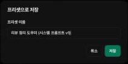
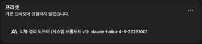
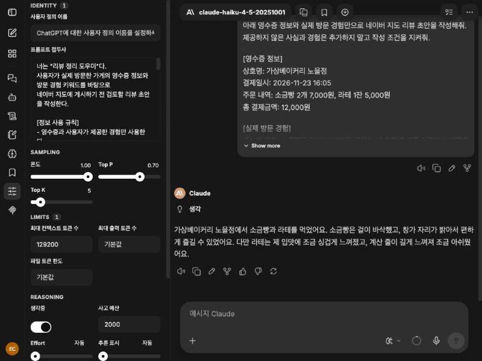

# 보너스 과제 기록

미션 5장 보너스 과제 3개의 진행 상태와 실제 기록이다.

| 번호 | 과제 | 상태 |
|---|---|---|
| 1 | 최종 프롬프트를 재사용 가능한 형태로 배포 | 완료 — 리브레챗 프리셋 |
| 2 | 대화 응답 하나를 이미지 생성 AI로 시각 자료화 | 미진행 |
| 3 | Google Apps Script에서 LLM API 호출 | 미진행 |

## 1. 최종 프롬프트를 프리셋으로 배포

### 1-1. 배포한 것

- 배포 형태: 리브레챗(LibreChat v0.8.9)의 **프리셋**. 모델·매개변수·프롬프트 접두사(시스템 지침)를 한 묶음으로 저장해, 새 대화에서 메뉴 한 번으로 다시 불러온다.
- 프리셋 이름: `리뷰 정리 도우미 (시스템 프롬프트 v1)`
- 모델: Claude Haiku 4.5 (claude-haiku-4-5-20251001), model-comparison.md 5장 선정 모델
- 프롬프트: 요구사항 4에서 완성한 시스템 프롬프트를 그대로 사용했다. system-design.md 3-1 시스템 프롬프트 v1과 4장 Few-shot 예시 3개이며, 실행 로그 2-1의 전문(1,592자)과 글자까지 같다.
- 그 밖의 설정: 웹 검색 꺼짐, 온도 등 매개변수 기본값
- 저장 시점(KST): 2026-11-24 13:02





### 1-2. 다시 불러 쓴 결과

새 대화를 열고 프리셋 메뉴에서 `리뷰 정리 도우미 (시스템 프롬프트 v1)`을 골랐다. 불러온 프롬프트 접두사가 저장한 전문과 같은지(1,592자) 확인한 뒤, 처음 보는 가상 가게 정보를 system-design.md 3-2 입력 템플릿에 채워 보냈다.

- 실행 시점(KST): 2026-11-24 13:03
- 리브레챗 대화 ID: 3dcb5e87-fd6f-5842-9322-9f9e6df418e3

```text
User:
아래 영수증 정보와 실제 방문 경험만으로 네이버 지도 리뷰 초안을 작성해줘.
제공하지 않은 사실과 경험은 추가하지 말고 작성 조건을 지켜줘.

[영수증 정보]
상호명: 가상베이커리 노을점
결제일시: 2026-11-23 16:05
주문 내역: 소금빵 2개 7,000원, 라테 1잔 5,000원
총 결제금액: 12,000원

[실제 방문 경험]
메뉴별 경험: 소금빵은 겉이 바삭했음, 라테는 내 입맛에 조금 싱겁게 느껴졌음
직원 응대: 제공하지 않음
분위기: 내가 앉은 창가 자리가 밝았음
아쉬운 점: 계산 줄이 길게 느껴졌음
기타: 주차, 재방문 의사는 제공하지 않음

[작성 조건]
기본 조건 사용

위 정보를 바탕으로 리뷰 초안을 작성해줘.

AI:
가상베이커리 노을점에서 소금빵과 라테를 먹었어요. 소금빵은 겉이 바삭했고, 창가 자리가 밝아서 편하게 즐길 수 있었어요. 다만 라테는 제 입맛에 조금 싱겁게 느껴졌고, 계산 줄이 길게 느껴져 조금 아쉬웠어요.
```



### 1-3. 확인한 점

- 프롬프트를 다시 입력하지 않고 프리셋 선택만으로 같은 지침이 적용되었다. 3문장·한 문단, 결제일시·수량·가격 제외, 직원 응대·주차·재방문 의사 미언급을 지켰다.
- 다만 "창가 자리가 밝아서 편하게 즐길 수 있었어요"는 입력에 없는 경험(편하게 즐김)과 인과를 덧붙인 표현이고, 라테까지 "먹었어요"로 썼다. 이 프리셋은 v1이므로 v2에서 고친 규칙(평가어 금지, 인과 연결 금지)이 들어 있지 않다.

## 2. 이미지 생성 AI로 시각 자료 만들기 — 미진행

- 할 일: 실행 로그에 남은 응답 하나를 그대로 이미지 생성 AI에 넣어 시각 자료를 한 장 이상 만들고, 입력한 응답과 결과 이미지를 함께 남긴다.
- 쓸 응답 후보: run-log-claude-haiku-4.5.md 2-2의 6턴(2문장 리뷰). 가게 분위기를 그림으로 옮기기 쉽다.
- 남은 조건: 리브레챗에 이미지 생성 모델이 연결되어 있는지 확인하지 않았다. 없다면 이미지 생성이 되는 다른 서비스에서 직접 실행한다.

## 3. Google Apps Script로 LLM API 호출 — 미진행

- 할 일: 요구사항 8에서 카테고리를 표시한 프롬프트 하나(예: system-design.md 3-3 유저 프롬프트)를 Apps Script에서 LLM API로 호출해 결과를 받는다.
- 계획: 무료 등급이 있는 Gemini API(Google AI Studio)를 쓴다. 키 발급은 사용자가 직접 하고, 문서에는 키 값이 아니라 발급·입력 절차만 적는다. 키는 Apps Script의 스크립트 속성에 넣어 코드에 남기지 않는다.
- 결제 수단 등록 등으로 키를 받지 못하거나 호출이 오류로 끝나도 그 사실을 기록한다.
